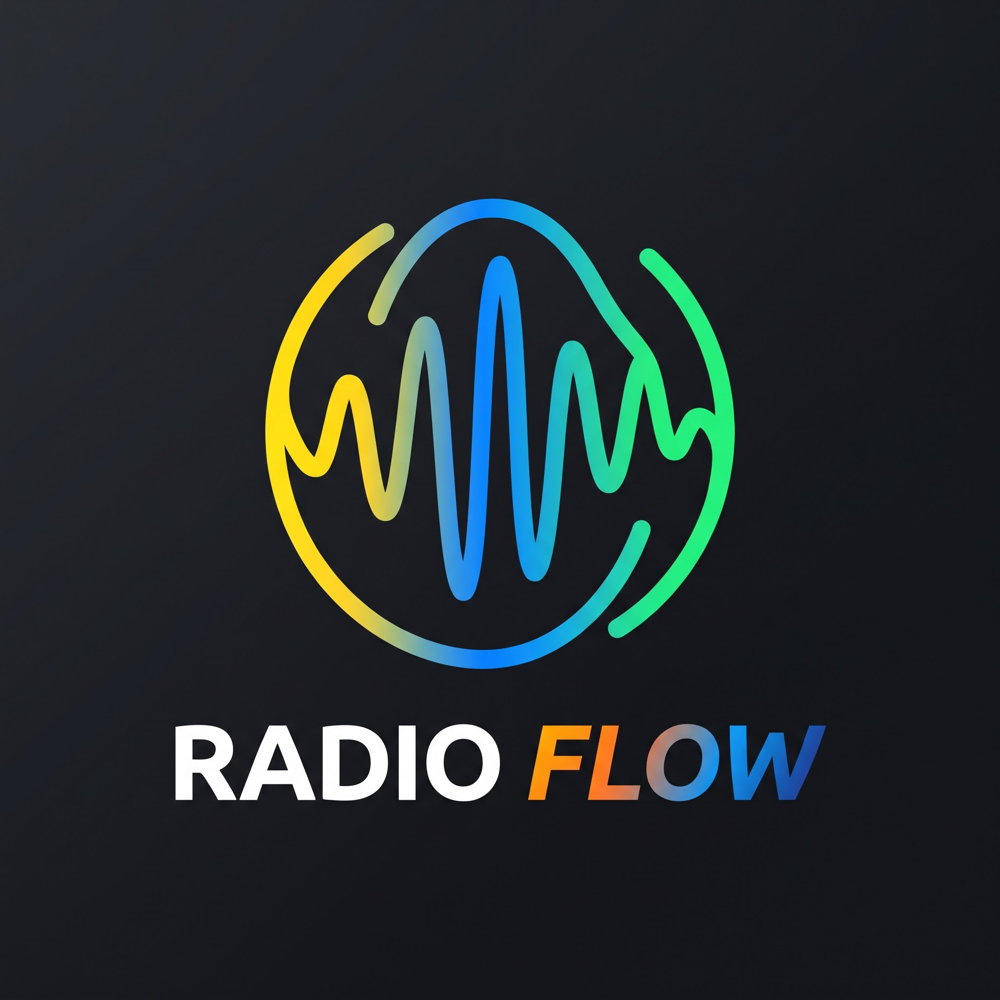

<p align="center">
  
</p>

# Radio Flow

[](https://github.com/chadracklonde/radioflow/actions/workflows/ci.yml)

Application multiplateforme (Android, iOS, macOS, Windows) qui structure la production d'une station radio : forum de rédaction, fils de discussion par sujet, conducteur dynamique, espace son avec nommage automatique des fichiers audio, tâches de l'équipe et tableau de bord avec export PDF / Excel.

Conçue par Chadrack Tambwe Londe pour RTC-MALI. Le cahier des charges et les décisions de conception sont résumés dans [`CONTEXT.md`](CONTEXT.md).

## Fonctionnalités

| Section | Ce qu'elle fait |
|---|---|
| **Forum** | Les journalistes proposent des sujets (angle, format, source); le rédacteur en chef valide, refuse ou demande des modifications, avec une note. |
| **Conducteur** | Génère les éditions du jour d'après la grille de la station; lignes réordonnables, statuts, verrouillage; un fil de discussion par ligne. |
| **Espace Son** | Fichiers audio classés par édition et par position, renommés automatiquement `[Position]_[Nom_Original]_[Date].[ext]`; lecture et téléchargement. |
| **Tâches** | Tâches de toute l'équipe en temps réel (en reportage, en montage, en rédaction...). |
| **Tableau de bord** | Classement des productions par journaliste, période hebdomadaire / mensuelle / sur mesure, export PDF et Excel. |
| **Équipe** | Réservée au super administrateur : création des comptes, attribution des rôles, désactivation. |
| **Mode hors ligne** | Propositions, tâches et messages écrits sans réseau sont envoyés automatiquement au retour de la connexion. |

Rôles : super administrateur (un seul compte), rédacteur en chef (`admin`), journaliste, technicien / présentateur.

## Architecture

- **Application** : Flutter (`radio_flow/`), Riverpod, go_router. Organisation par fonctionnalité (`lib/features/...`), détails dans [`docs/ARCHITECTURE.md`](docs/ARCHITECTURE.md).
- **Serveur** : Supabase (PostgreSQL, Auth, Storage, Realtime). Le schéma, les règles d'accès (RLS) et les garde-fous sont dans `supabase/migrations/`.
- **Fonction serveur** : `supabase/functions/manage-team` (création et désactivation de comptes). La clé de service reste côté serveur.
- **Hors ligne** : base SQLite locale (file d'envoi + dernières données consultées).
- **Design** : système de design généré avec le skill UI/UX Pro Max, voir `design-system/radio-flow/MASTER.md`.

## Démarrer

Prérequis : [Flutter](https://docs.flutter.dev/get-started/install) 3.47 ou plus récent. Windows se compile sous Windows, iOS et macOS sous macOS.

```bash
cd radio_flow
flutter pub get
flutter run -d windows      # ou macos, ou un appareil / émulateur Android
```

L'application pointe par défaut vers le projet Supabase de l'équipe. Pour un autre projet :

```bash
flutter run --dart-define=SUPABASE_URL=https://<projet>.supabase.co \
            --dart-define=SUPABASE_PUBLISHABLE_KEY=<clé publishable>
```

(La clé « publishable » est publique par conception; ne mettez jamais une clé secrète ou de service dans l'application.)

## Base de données et fonction serveur

```bash
# Migrations, dans l'ordre des noms de fichiers : supabase/migrations/*.sql
# Tests de sécurité sur un PostgreSQL jetable (voir supabase/tests/) :
PGHOST=localhost PGUSER=postgres PGPASSWORD=postgres PGDATABASE=postgres bash supabase/tests/run.sh
```

La fonction `manage-team` se déploie avec la CLI Supabase (`supabase functions deploy manage-team`), JWT obligatoire.

Premier compte : créez l'utilisateur dans Supabase (Authentication > Users), puis désignez-le super administrateur depuis l'éditeur SQL :

```sql
update public.users set is_super_admin = true, role = 'admin' where email = 'vous@exemple.com';
```

Les autres membres se créent ensuite dans l'application : Mon compte > Gérer l'équipe.

## Identité visuelle

Le logo d'origine est dans [`docs/branding/`](docs/branding/radio-flow-logo.jpg). Les icônes de l'application (Android adaptatif, iOS, macOS, Windows) et l'emblème utilisé dans l'interface en sont dérivés :

```bash
python3 tools/make_brand_assets.py                    # produit radio_flow/assets/branding/*.png (Pillow + NumPy)
cd radio_flow && dart run flutter_launcher_icons      # écrit les icônes de chaque plateforme
git checkout -- ios/Runner.xcodeproj/project.pbxproj  # voir la note ci-dessous
```

Note : `flutter_launcher_icons` remplace à tort un réglage du fichier de projet iOS (`ASSETCATALOG_COMPILER_GENERATE_SWIFT_ASSET_SYMBOL_EXTENSIONS`) par `AppIcon`. Il faut annuler cette modification avec la dernière commande.

## Qualité et CI

Le workflow [`CI`](.github/workflows/ci.yml) s'exécute à chaque envoi et chaque demande de fusion :

- **Flutter** : `flutter analyze` et `flutter test` (tests de widgets, accessibilité WCAG, hors ligne, exports).
- **Base de données** : toutes les migrations sur PostgreSQL 16, puis ~40 contrôles de sécurité (droits par rôle, verrouillage, super administrateur...).
- **Fonction serveur** : `deno check`.
- **Secrets** : refuse tout secret versionné.

Le workflow [`Build des plateformes`](.github/workflows/build.yml) (lancement manuel) compile Android, Windows, macOS et iOS. Il n'a pas encore été exécuté.

## État et limites connues

- Les polices Fira Sans / Fira Code ne sont pas encore embarquées (`radio_flow/assets/fonts/`); l'application utilise la police du système en attendant.
- Hors ligne : les décisions du Forum, l'édition du Conducteur et l'envoi de fichiers audio nécessitent le réseau.
- Un compte désactivé peut rester actif jusqu'à une heure (durée de sa session déjà ouverte).
- La protection contre les mots de passe compromis (Supabase Auth) n'est pas disponible sur le plan gratuit.
